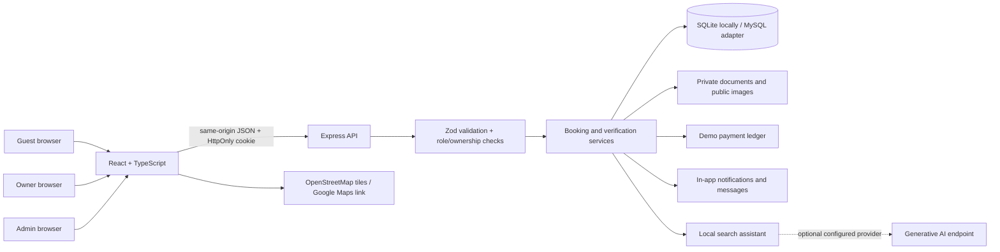
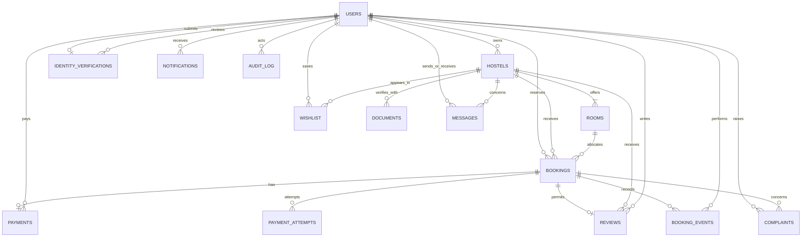
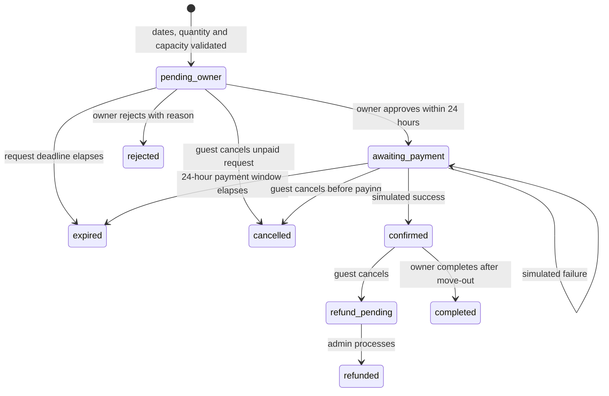
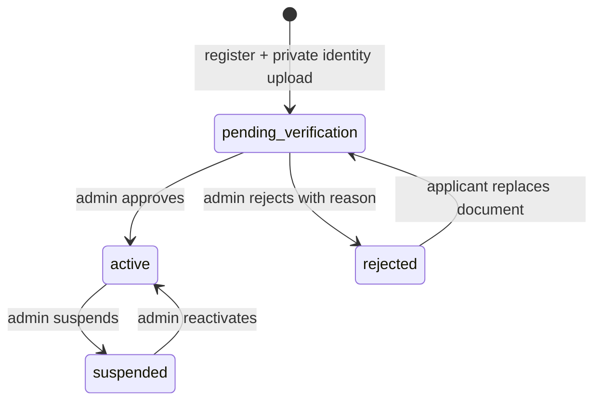
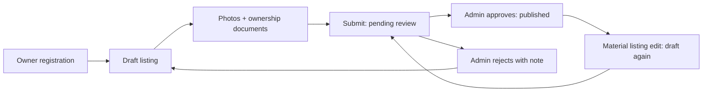

# Architecture

The dedicated stack slide specifies React/TypeScript, Express, MySQL, JWT/bcrypt and Razorpay. The architecture illustration instead shows Flask. This implementation consistently follows the dedicated stack slide for frontend/backend/authentication, adds SQLite for a zero-install local database, and implements the user-selected demo payments instead of a live Razorpay integration.

## Components

Express serves the built SPA and API together on port 4000. In development, Vite on port 5173 proxies API and upload requests to Express. No browser-local storage is used for bookings, profiles, payments, messages or notifications. Only the comparison shortlist is device-local.

## Entities

Owner accounts use the `users.role` discriminator instead of a duplicate credentials table. Facilities and ordered photo URLs are JSON strings in a hostel row. `server/plans.js` is the authority for Basic and Advanced prices, quotas and entitlements. The current plan remains on the owner account; `subscription_attempts` records simulated processing/failure and successful payments are written to the common ledger with a plan code. A production billing extension should add explicit subscription periods and provider webhook events.

## Booking states

Expired status is derived from `expires_at`; inventory excludes expired unpaid holds without a scheduled cleanup job. Date intervals are `[start_date, end_date)`, so a bed can be reused on move-out day. Version-2 bookings collect discounted first-month rent, a one-time deposit, first-month food/services and configured tax for 1–4 beds. The listing's minimum stay is enforced, with a maximum of 366 nights. Later monthly charges are displayed but are not automatically collected. Prices and refunds use integer INR.

Additive migrations preserve existing version-1 bookings and their original payment-before-approval transitions and prices. All newly created bookings follow the diagram above.

Capacity is a bed count per room type. A quantity-weighted sweep of overlapping reservation boundaries computes peak occupied beds. SQLite uses `BEGIN IMMEDIATE`; API requests are serialized around its shared connection. MySQL locks the room before checking and writing a reservation. Confirmed stays retain capacity; version-2 pending requests and approved unpaid bookings retain it only until their respective deadlines.

Payment attempts have unique idempotency keys and separate processing/failure outcomes. Finalization locks and rechecks the booking, and a unique booking payment prevents duplicate collection. Prices are captured at reservation time. Unpaid cancellation or rejection creates no refund. Paid cancellation before move-in requests a full refund; on/after move-in it refunds the deposit. Legacy paid owner rejection requests a full refund. Net collections deduct processed refund amounts, preserving the retained portion of partially refunded payments.

## CSV data lifecycle

Seventeen editable CSV files feed a deterministic validation and transactional import pipeline. Foreign keys, dates, amounts, enum values and quantity-weighted capacity are checked before import. `seed_records` stores source/applied hashes; untouched managed profiles and listings may be updated, while live edits and existing financial history are preserved. `seed_imports` records successful and failed runs for the admin dashboard. Dates are rebased once to the first import date, then remain stable. A fresh-dataset command creates a separate database and refuses to overwrite existing files. See [CSV data guide](CSV-DATA-GUIDE.md).

## Booking history and action queues

Booking events are appended in the same transaction as the state change, payment and notifications. Each event snapshots the actor name/role and any decision note. The additive `booking_events` table is created on startup without resetting existing data; historical decisions are not backfilled. A private detail endpoint enforces the same ownership scope as the list. The UI obtains current allowed actions and refund quotes from the server, then sends optional status/amount preconditions to reject stale decisions. Unpaid expiry is derived from the clock rather than a stored event. Lists refresh every 15 seconds while visible, with a server-adjusted local countdown between refreshes.

## Verification states

New self-registered residents and owners are stored as pending and receive no session. Identity files are limited to 5 MB JPEG, PNG or PDF content, use generated private names and are available only through an admin-authorized endpoint. Approval/rejection records the reviewer, time, required note, notification and audit entry. Existing seeded accounts are active legacy/demo records.

Hostel listing verification is separate:

Listing uploads enforce an 8 MB size limit and supported file signatures. Private documents never use the public static-file route. Listing documents are available to their owner and admins; account identity documents are admin-only. Listing approval requires a pending listing with documents. Room capacity changes cannot reduce capacity below existing reservations’ peak demand.

## Security boundaries

- bcrypt password hashes, JWTs in HttpOnly SameSite=Strict cookies; secure cookies in production.
- Database-backed account status and token version checked on every authenticated request. Logout, password change and suspension revoke tokens.
- Mutation requests require a custom same-origin header and an accepted Origin when present. Express JSON limits, Helmet and rate limiting protect the local API surface.
- Prepared SQL parameters, validated enum/range inputs and server-calculated financial amounts.
- Role and record-ownership checks on every management action. Guests cannot register as admins or access another guest’s booking.
- CSV export prefixes formula-like values to avoid spreadsheet formula interpretation.
- Audit records for administrative and booking decisions.

This is one local application, not a horizontally scaled production service. The rate limiter is in memory, assets are on disk, and local users share a process. Real money processing, email/SMS, verification of real businesses, malware scanning and production operations require additional integrations and validation.
